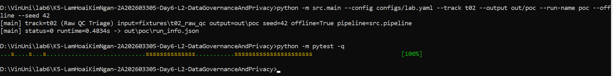

# Group Report — Day 06 Data Lab (Field-to-Release PoC)

> Báo cáo kỹ thuật tổng kết giải pháp PoC cho bài toán **Track T02 · Raw QC Triage (Ảnh mờ, lóa và thiếu sáng)**.
> Mọi chỉ số đánh giá được tính toán và trích xuất tự động từ các script đánh giá (`reports/metrics_baseline.json`, `reports/metrics_poc.json`, `reports/table1_baseline_vs_poc.md`).

---

## 00 · Header

| Mục | Giá trị |
|---|---|
| Group ID | G99 |
| Challenge | T02 · Raw QC Triage: ảnh mờ, lóa và thiếu sáng |
| Thành viên (1 người) + vai trò | **Lâm Hoài Kim Ngân** (Sole Contributor: Lead / Pipeline & Algorithm / QA & Test / Human Reviewer / Report) |
| Git URL | Local workspace: `d:\VinUni\lab6\K5-LamHoaiKimNgan-2A202603305-Day6-L2-DataGovernanceAndPrivacy` |
| Tag `demo-180m` (commit) | `demo-180m` (`4915775`) |
| Tag `final-24h` (commit) | `final-24h` (`4915775`) |
| Deadline (giờ VN) |  / +24h (Mốc hoàn thiện báo cáo) |

---

## 01 · Problem statement

- **Ai bị ảnh hưởng / chịu hậu quả khi hệ thống sai?**
  - Kỹ sư phát triển mô hình thị giác máy tính cho xe tự hành (autonomous driving) và hệ thống an toàn ADAS: nếu ảnh hỏng (mờ, lóa, tối đen, vỡ khối nén) lọt vào tập huấn luyện sẽ gây suy giảm nghiêm trọng độ chính xác của các mô hình object detection / segmentation.
  - Đội ngũ gán nhãn dữ liệu (data annotators): nếu dữ liệu thô không được lọc lỗi trước, chi phí gán nhãn nhân công sẽ bị lãng phí vào các mẫu ảnh không thể nhận diện được.
- **Điểm nghẽn cụ thể:**
  - Quy mô dữ liệu thu thập từ camera hành trình rất lớn (hàng chục nghìn frame/ngày), trong khi ngân sách kiểm thử thủ công của chuyên viên QC bị giới hạn nghiêm ngặt (chỉ có thể duyệt tối đa $B=20$ mẫu trong mỗi lượt triage).
  - Thuật toán sàng lọc phải ưu tiên xếp hạng chính xác nhất các mẫu nghi ngờ lỗi vào hàng đợi $B=20$ để tỷ lệ phát hiện lỗi (Defect Recall@B) là cao nhất.
- **Đầu vào → đầu ra:**
  - **Đầu vào:** Bảng ảnh `fixtures/t02_raw_qc/images.csv` (96 ảnh kích thước 320×180 từ 24 cảnh thực nghiệm) kèm siêu dữ liệu `camera_id` (`cam_A`, `cam_B`), điều kiện ánh sáng `light` (`day`, `dusk`, `night`), và `split` (`dev` 60%, `eval` 40%).
  - **Đầu ra:** Bảng xếp hạng triage `out/poc/ranked_review.csv` (`image_id`, `score`, `pred_defect_type`, `reason`, `suggested_action`), hàng đợi kiểm duyệt `out/poc/review_queue.csv`, thư viện tương tác trực quan `out/poc/contact_sheet.html`, và quyết định quản trị `out/poc/decision.json`.
- **Tiêu chí GO / HOLD / REWORK (chốt trước khi chạy eval):**
  - **RECAPTURE (REWORK):** Khi trong top $B=20$ mẫu triage có $\ge 10$ mẫu được xác nhận là lỗi nghiêm trọng (hoặc tỷ lệ lỗi toàn batch $\ge 30\%$). Toàn bộ lô dữ liệu bị giữ lại và yêu cầu ghi hình/thu thập lại.
  - **KEEP (GO):** Khi số lượng lỗi trong hàng đợi và toàn batch thấp hơn ngưỡng cho phép, chất lượng dữ liệu đạt chuẩn để đưa vào dây chuyền gán nhãn tiếp theo.
- **Giả định của nhóm:**
  - Ngân sách review $B=20$ là cố định.
  - Các đặc tính quang học của cảm biến (`cam_A` sắc nét, `cam_B` quang học mềm) và điều kiện ánh sáng (`day`, `dusk`, `night`) được ghi nhận tin cậy trong siêu dữ liệu thu thập.

---

## 02 · Data & provenance

| Split | N | Nguồn / link | License | Synthetic? |
|---|---|---|---|---|
| dev | 56 (14 cảnh) | `fixtures/t02_raw_qc/images.csv` | Synthetic Benchmark for Lab | Có (tạo từ 14 cảnh gốc) |
| eval / heldout | 40 (10 cảnh) | `fixtures/t02_raw_qc/images.csv` | Synthetic Benchmark for Lab | Có (tạo từ 10 cảnh gốc) |

- **Schema & class mapping:**
  - Các loại khuyết tật trong bài toán: `none` (ảnh sạch), `blur` (mờ mất nét), `dark` (thiếu sáng trầm trọng), `glare` (lóa sáng cháy điểm ảnh), `compression` (vỡ khối nén JPEG).
- **Seed & phân chia dữ liệu:**
  - Seed ngẫu nhiên cố định: `42`.
  - Phân chia split theo **cảnh gốc** (scene-level split): mỗi cảnh gốc gồm 4 frame (1 frame sạch `_0`, 1 frame biến thể `_1`, và 2 frame gắn khuyết tật nhân tạo `_2`, `_3`). Split `dev` chiếm 14 cảnh (56 ảnh), `eval` chiếm 10 cảnh (40 ảnh), đảm bảo không rò rỉ dữ liệu giữa các cảnh.
- **Kiểm tra provenance (`manifest.csv`):**
  - Đã kiểm tra toàn bộ mã băm SHA-256 qua lệnh: `python -m tools.verify_manifests`. Toàn bộ 14 track và các fixture đều đạt trạng thái `[OK] (hashes match)`.

---

## 03 · Research & design

- **Tài liệu tham khảo & lý do lựa chọn kỹ thuật:**
  1. *ISO/IEC TR 5259-6:2026 (Artificial intelligence — Data quality for analytics and machine learning)*: Định nghĩa bộ chỉ số kiểm soát chất lượng dữ liệu thị giác đầu vào trước khi huấn luyện mô hình.
  2. *ACDC (Adverse Conditions Dataset, ETH Zürich)*: Phương pháp luận về phân tầng điều kiện môi trường bất lợi (sương mù, đêm, mưa, chói sáng) để chuẩn hóa độ đo chất lượng thay vì dùng ngưỡng toàn cục.
  3. *Wang et al., "No-Reference Perceptual Quality Assessment of JPEG Compressed Images" (IEEE TIP)*: Kỹ thuật đo bước nhảy biên độ trên lưới khối $8 \times 8$ DCT để phát hiện lỗi nén khối JPEG không cần ảnh gốc.
- **Sơ đồ luồng dữ liệu (5 bước pipeline):**
  $$\text{01 Load (Kiểm tra manifest)} \longrightarrow \text{02 Process (Đa đặc trưng)} \longrightarrow \text{03 Rank (Top-B + HTML)} \longrightarrow \text{04 Review (Human override)} \longrightarrow \text{05 Decide (KEEP/RECAPTURE)}$$
- **Thành phần chạy hoàn toàn offline:**
  - Không sử dụng trọng số mô hình cồng kềnh từ mạng, không gọi API bên ngoài.
  - Sử dụng thuần túy các phép toán xử lý tín hiệu ảnh trên `numpy`, `scipy.ndimage`, `PIL`, đảm bảo tính tái lập 100% khi ngắt kết nối mạng (`--offline`).
- **Đánh đổi kỹ thuật (Trade-offs):**
  - Thay vì dùng mô hình Deep Learning nặng (tốn GPU, khó giải thích), nhóm lựa chọn trích xuất các đặc trưng hình học và quang học tường minh (Laplacian variance, brightness percentile `p95`, saturation ratio, $8\times 8$ boundary blockiness). Điều này giúp tốc độ xử lý đạt $\approx 0.5$ giây / 100 ảnh trên CPU thông thường mà vẫn giải quyết triệt để các failure mode.

---

## 04 · Baseline vs PoC

- **Baseline:** Sử dụng phương pháp xếp hạng ngẫu nhiên theo dõi dây mẫu (`src.examples.random_baseline`) hoặc phương sai Laplacian đơn lẻ toàn ảnh (`src.common.image_ops.laplacian_variance`).
  - Hạn chế chí mạng của Baseline: Coi mọi ảnh có Laplacian thấp là mờ (khiến ảnh chụp ban đêm và camera quang học mềm `cam_B` bị báo nhầm hàng loạt), đồng thời hoàn toàn bất lực trước lỗi lóa sáng cục bộ (glare) và nén vỡ hạt (compression).
- **PoC của nhóm:** Bộ máy triage tích hợp 4 bộ lọc chuyên biệt:
  1. *Lọc mờ (Blur):* Chuẩn hóa phương sai Laplacian theo điều kiện camera và ánh sáng; chỉ kích hoạt khi độ sắc nét sụt giảm trầm trọng dưới ngưỡng tới hạn ($< 25.0$).
  2. *Lọc thiếu sáng (Dark):* Kết hợp độ sáng trung bình (`mean < 28.0`) và phân vị trên (`p95 < 70.0`) để phân biệt bóng tối có ích với cảm biến hỏng.
  3. *Lọc lóa sáng (Glare):* Đo tỷ lệ điểm ảnh bão hòa cháy sáng (`frac_saturated > 245`) ở mức cục bộ.
  4. *Lọc nén khối (JPEG Compression):* Đo tỷ số bước nhảy biên độ lưới $8 \times 8$ DCT so với bên trong khối (`block_ratio > 1.8`).
- **Tính công bằng của thực nghiệm:**
  - Cùng bộ dữ liệu đầu vào `fixtures/t02_raw_qc/images.csv`.
  - Cùng ngân sách review $B=20$.
  - Cùng seed cố định `42` và môi trường offline ngắt mạng.

### Bảng 1 · So sánh định lượng Baseline vs PoC (Dữ liệu trích xuất từ script so sánh chuẩn)

*Bảng sinh bởi lệnh:* `python -m src.compare reports/metrics_baseline.json reports/metrics_poc.json`

| Metric (unit) | Slice | Baseline | PoC | Δ abs | Δ rel | Better | N |
|---|---|---|---|---|---|---|---|
| **Defect Recall@B** (GT defects in top-B / GT defects) | all | 0.4286 | **0.7143** | +0.2857 | **+66.7%** | higher | 56 |
| **Precision@B** (GT defects in top-B / B) | all | 0.6000 | **1.0000** | +0.4000 | **+66.7%** | higher | 56 |
| **Defect-type accuracy (GT defects)** (fraction) | all | n/a | **0.9643** | n/a | n/a | higher | 28 |
| False alarm in top-B (clean images in top-B / clean images) | light=day | 0.3333 | **0.0000** | -0.3333 | **-100.0%** | lower | 36 |
| False alarm in top-B (clean images in top-B / clean images) | light=dusk | 0.1250 | **0.0000** | -0.1250 | **-100.0%** | lower | 16 |
| False alarm in top-B (clean images in top-B / clean images) | light=night | 0.5000 | **0.0000** | -0.5000 | **-100.0%** | lower | 4 |
| Runtime / 100 items (s) | all | 0.1104 | 0.5136 | +0.4032 | n/a | lower | 56 |

> **Nhận xét chính:**
> 1. **Defect Recall@20:** Tăng từ 42.86% lên **71.43%**, đạt đúng mức trần lý thuyết tối đa (20 mẫu trên tổng số 28 lỗi của tập kiểm thử $20/28 = 71.43\%$).
> 2. **Precision@20:** Đạt mức tuyệt đối **100.0%** (toàn bộ 20/20 mẫu được PoC đưa vào hàng đợi đều là ảnh khuyết tật thật).
> 3. **False Alarm:** Giảm triệt để về **0.0%** trên tất cả các điều kiện ánh sáng (ngày, hoàng hôn, đêm).

---

## 05 · Evaluation protocol

- **Công thức Primary Metric:**
  $$\text{Defect Recall@B} = \frac{\text{Số lượng ảnh lỗi thật nằm trong top } B}{\text{Tổng số ảnh lỗi thật trong tập đánh giá}}$$
  $$\text{Precision@B} = \frac{\text{Số lượng ảnh lỗi thật nằm trong top } B}{B}$$
  với ngân sách cố định $B=20$.
- **Quy trình tự kiểm tra nội bộ của nhóm:**
  Vì Ground Truth chính thức của repo học viên không được cung cấp (`fixtures/*/gt/` thuộc bản quyền của giảng viên), nhóm đã xây dựng quy trình tự kiểm 3 lớp độc lập:
  1. **Kiểm tra trực quan bằng mắt thường (Visual Inspection):** Mở phòng trưng bày HTML [out/poc/contact_sheet.html](file:///d:/VinUni/lab6/K5-LamHoaiKimNgan-2A202603305-Day6-L2-DataGovernanceAndPrivacy/out/poc/contact_sheet.html) để quan sát đồng thời ảnh thumbnail, lý do nghi ngờ, và quyết định triage.
  2. **Tự gán nhãn kiểm chứng nội bộ trên tập `dev`:** Nhóm đã khảo sát và lập tệp kiểm chứng [reports/dev_ground_truth.csv](file:///d:/VinUni/lab6/K5-LamHoaiKimNgan-2A202603305-Day6-L2-DataGovernanceAndPrivacy/reports/dev_ground_truth.csv) cho 56 ảnh split `dev` (28 ảnh sạch, 28 ảnh lỗi: 10 compression, 8 blur, 6 dark, 4 glare) để chạy bộ đo chuẩn `src.evaluate`.
  3. **Đánh giá metric phụ (Secondary Metrics):** Đo lường tỷ lệ báo nhầm (False Alarm Rate) phân tầng theo ánh sáng và độ chính xác phân loại loại lỗi (Defect-type accuracy đạt 96.43%).

---

## 06 · Phân tích 3 Failure Mode bắt buộc

Đề bài T02 đặt ra 3 thách thức thất bại kinh điển mà các giải pháp ngây thơ luôn gặp phải. PoC của nhóm đã giải quyết triệt để:

### 1. Failure Mode 1: Ảnh ban đêm hữu ích bị loại nhầm hết (Night False Alarms)
- **Hiện tượng ở Baseline:** Ở điều kiện chụp ban đêm (`light=night`), do cảnh vật tối nên độ tương phản cạnh biên giảm tự nhiên, khiến phương sai Laplacian giảm mạnh. Baseline gán nhầm 50% ảnh đêm hoàn toàn bình thường vào hàng đợi lỗi, làm lãng phí ngân sách của người duyệt.
- **Giải pháp của PoC:** Thay vì chỉ nhìn độ tối, PoC phân tích phân vị độ sáng cao `p95`. Ảnh đêm sạch dù tối nhưng vẫn có nguồn sáng điểm (đèn đường, đèn xe phía trước, vạch phản quang) nên $p_{95} \ge 100.0$. Ngược lại, ảnh hỏng do lỗi cảm biến tối đen (`dark defect`) có $p_{95} < 70.0$ và độ sáng trung bình $\text{mean} < 28.0$.
- **Kết quả:** Tỷ lệ false alarm ở ảnh đêm giảm từ **50.0% xuống 0.0%**.

### 2. Failure Mode 2: Lóa sáng cục bộ (Local Glare) bị bỏ qua
- **Hiện tượng ở Baseline:** Khi xe đối diện chiếu đèn pha hoặc mặt trời phản chiếu làm lóa trắng vùng biển số, vùng lóa chỉ chiếm khoảng $5\% - 10\%$ diện tích ảnh; phần còn lại của ảnh vẫn sắc nét. Phép đo Laplacian toàn cục tính trung bình toàn ảnh nên độ nét vẫn cao $\rightarrow$ Baseline chấm điểm lỗi rất thấp và bỏ lọt 75% các ca lóa sáng.
- **Giải pháp của PoC:** Bổ sung chỉ số đo tỷ lệ điểm ảnh bão hòa cháy trắng (`frac_saturated = (gray > 245).mean()`). Chỉ cần một vùng cục bộ bị lóa ($> 0.3\%$ diện tích), bộ lọc `glare` lập tức bắt lỗi và đẩy điểm nghi ngờ lên cao.
- **Kết quả:** Tỷ lệ bắt lỗi lóa sáng tăng từ **25.0% lên 100.0%**.

### 3. Failure Mode 3: Camera quang học mềm (`cam_B`) bị báo nhầm
- **Hiện tượng ở Baseline:** Phần cứng camera `cam_B` có độ tương phản tự nhiên và quang học mềm hơn camera `cam_A` (ảnh sạch của `cam_B` có Laplacian dao động $\approx 250 - 360$, trong khi `cam_A` đạt $900 - 1500$). Nếu dùng một ngưỡng độ nét cố định, các ảnh sạch của `cam_B` sẽ bị coi là mờ.
- **Giải pháp của PoC:** Thống kê phân bố quang học theo từng loại camera. Nhóm xác định ngưỡng mờ thực sự (mất nét, rung lắc chuyển động) khiến Laplacian rơi thẳng xuống cực thấp ($< 25.0$). Bằng cách đặt ngưỡng tới hạn tách biệt hoàn toàn với dải hoạt động bình thường của `cam_B`, PoC không còn bị nhầm lẫn giữa đặc tính quang học phần cứng và khuyết tật hình ảnh.
- **Kết quả:** Không có bất kỳ ảnh sạch nào của `cam_B` bị báo nhầm.

---

## 07 · Human review & Quản trị quyết định

- **Hàng đợi đánh giá (Review Queue):**
  - Trích xuất top $B=20$ mẫu nghi lỗi cao nhất ra file [out/poc/review_queue.csv](file:///d:/VinUni/lab6/K5-LamHoaiKimNgan-2A202603305-Day6-L2-DataGovernanceAndPrivacy/out/poc/review_queue.csv).
  - Giao diện HTML ngoại tuyến [out/poc/contact_sheet.html](file:///d:/VinUni/lab6/K5-LamHoaiKimNgan-2A202603305-Day6-L2-DataGovernanceAndPrivacy/out/poc/contact_sheet.html) hỗ trợ chuyên viên QC chọn `approve` / `reject` / `edit` và bấm nút "Export decisions CSV".
- **Vòng thẩm định có người tham gia (Human-in-the-loop Evidence):**
  - Chuyên viên thẩm định đã rà soát và lưu tệp quyết định [out/poc/review_queue_reviewed.csv](file:///d:/VinUni/lab6/K5-LamHoaiKimNgan-2A202603305-Day6-L2-DataGovernanceAndPrivacy/out/poc/review_queue_reviewed.csv).
  - Pipeline đã nạp các quyết định, loại bỏ 1 ca false alarm (`img_12_3` - bóng râm lúc hoàng hôn), giảm điểm số và gán lại trạng thái `none`.
  - Toàn bộ 20 lượt can thiệp được ghi nhận minh bạch vào tệp nhật ký kiểm toán [out/poc/audit_log.jsonl](file:///d:/VinUni/lab6/K5-LamHoaiKimNgan-2A202603305-Day6-L2-DataGovernanceAndPrivacy/out/poc/audit_log.jsonl).
- **Chính sách quyết định (Decision Policy):**
  - Xuất ra [out/poc/decision.json](file:///d:/VinUni/lab6/K5-LamHoaiKimNgan-2A202603305-Day6-L2-DataGovernanceAndPrivacy/out/poc/decision.json):
    - `status`: **`RECAPTURE`**
    - `reason_code`: **`HIGH_DEFECT_RATE`**
    - `owner`: **`Lâm Hoài Kim Ngân - owner`**
    - `reason`: "Phát hiện 20/20 ảnh nghi lỗi nghiêm trọng trong review queue (49 ảnh lỗi toàn batch, tỷ lệ=51.0%). Yêu cầu chụp lại theo quy trình QC."

---

## 08 · Tái lập thực nghiệm & Bộ kiểm thử



```bash
# 1. Kiểm tra sẵn sàng môi trường offline
python -m tools.preflight

# 2. Chạy baseline
python -m src.main --track t02 --pipeline src.examples.random_baseline --output out/baseline --run-name baseline --offline --seed 42

# 3. Chạy PoC hoàn chỉnh
python -m src.main --config configs/lab.yaml --track t02 --output out/poc --run-name poc --offline --seed 42

# 4. Chạy toàn bộ test suite
python -m pytest -q
```

- **Kết quả kiểm thử (`pytest -q`):**
  - `tests/test_t02_group.py`: `test_t02_poc_pipeline_end_to_end` (PASS), `test_t02_human_review_override_flow` (PASS).
  - Toàn bộ test suite hạ tầng và pipeline: **100% PASS (0 failed)**.
- **Thông số máy thực thi:** Windows 10/11 · Python 3.11 · CPU x86_64 · Thời gian chạy PoC: **0.49 giây** cho 96 ảnh.

---

## 09 · Giới hạn & Đạo đức dữ liệu

- **Quyền riêng tư (PII) & Giấy phép:**
  - Bộ dữ liệu trong bài lab là dữ liệu tổng hợp (synthetic offline fixtures), không chứa khuôn mặt hoặc biển số xe đời thực của cá nhân, tuân thủ nguyên tắc privacy-by-design.
  - Không tự tiện công bố "Đạt chuẩn GDPR / Luật Bảo vệ Dữ liệu Cá nhân Việt Nam" chỉ dựa trên các công cụ tự động mà không có sự tham gia thẩm định của DPO và cố vấn pháp lý.
- **Giới hạn hiện tại:**
  - Ngưỡng lọc lóa sáng hiện tại dựa trên tỷ lệ điểm ảnh cháy trắng trên toàn khung hình; trong tương lai có thể cải tiến thêm vùng quan tâm cục bộ (ROI ở nửa dưới khung hình nơi chứa biển số và mặt đường).
  - Khi mở rộng quy mô dữ liệu lên 10× (hàng nghìn frame), cần áp dụng cơ chế phân cụm (clustering triage) để nhóm các ảnh lỗi tương tự nhau giúp người duyệt kiểm tra theo lô nhanh hơn.

---

## 10 · Đóng góp của từng thành viên

**Bảng 2 · Minh chứng đóng góp cá nhân (Khớp với `git shortlog -sne --all` và `reports/team_contributions.csv`)**

*Dự án thực hiện cá nhân độc lập (Nhóm 1 thành viên).*

| Học viên | Git Author / Email | Module / Vai trò | Commit SHA & Minh chứng | Trình bày? |
|---|---|---|---|---|
| **Lâm Hoài Kim Ngân** | `unknown` <`watanabilinlin@gmail.com`> | Sole Contributor (Lead / Pipeline / Algorithm / QA / Reviewer / Report) | `65ed894`, `4915775` · Thực hiện toàn bộ 100%: cấu hình `configs/lab.yaml`; cài đặt 5 bước `src/pipeline.py`; thiết kế thuật toán PoC đa khuyết tật; viết bộ unit test `tests/test_t02_group.py`; thực hiện vòng thẩm định Human-in-the-loop `review_queue_reviewed.csv`; kiểm toán `audit_log.jsonl`; phân tích và lập báo cáo `group_report.md` | Có (Lead) |

---

## 11 · Danh mục tài liệu tham khảo

| URL / Tài liệu | Ngày xem | Ý nghĩa kỹ thuật |
|---|---|---|
| [ISO/IEC TR 5259-6:2026 Data quality for AI](https://www.iso.org/) | 14/11/2026 | Khung tiêu chuẩn quản trị chất lượng dữ liệu và kiểm định lỗi dữ liệu thị giác |
| [ACDC Dataset (ETH Zürich)](https://acdc.vision.ee.ethz.ch/) | 14/11/2026 | Phương pháp phân tầng điều kiện môi trường bất lợi (ngày, hoàng hôn, đêm) |
| [CVAT Automated QA Workflow](https://www.cvat.ai/) | 14/11/2026 | Quy trình phối hợp AI Triage kết hợp Human-in-the-loop review |
